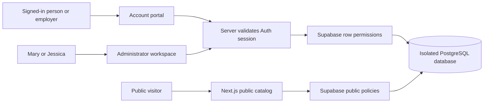

# Architecture

The application separates public discovery, private account services and the team workspace. Next.js App Router and TypeScript provide the interface and server routes; Supabase supplies PostgreSQL, Auth and database authorization. Vercel hosts the isolated preview. Plain CSS implements the Back2KC palette, responsive layouts and native accessible controls without adding a component framework.

## Request flow

`/api/catalog` uses a public Supabase client and an explicit public field projection. Published, reviewed records are returned without candidate profiles or employer conversation notes. `/api/portal` validates the signed-in account and relies on row permissions for ownership. `/api/admin` additionally requires the protected administrator role. Form handlers validate fields and request origin before writing through the authenticated database client.

## Main records

| Area | Records and purpose |
| --- | --- |
| Employer directory | Organizations, verified office locations, verified organization memberships |
| Opportunities | Job postings, actual job locations, explicit remote eligibility |
| Community | Resources, resource eligibility, events, employer/resource event links |
| Talent | Private candidate profiles and purpose-specific consent history |
| Team work | Employer conversations, job needs, introduction requests, approved introductions, tasks and outcomes |
| Review and provenance | Submissions, evidence sources, import batches, original import records, identity mappings and audit history |

Public and private employer fields live in different tables. An organization's headquarters does not determine a job's work state. Candidate current location and preferred work states are separate fields. All exposed application tables have Row Level Security. Account metadata cannot grant a privileged role.

## Geography and publication

The independent region and category controls retain URL search preferences. Region is also stored in `come-home-kc-region`, leaving the original prototype's key unchanged. State filtering requires verified office locations, verified job locations, explicit remote eligibility or verified resource eligibility. Unknown-location research employers can appear in All KC with a confirmation label.

Jobs become public only after employer verification, publication review, valid application details, confirmed geography and a future closing date. Employer edits return a job to review. Closed or expired jobs disappear from active discovery. The browser repeats presentation checks, while database policies enforce access.

## Human decisions

The team reviews submissions, verifies companies and locations, confirms both parties' permission before an introduction, and records the supporting evidence for outcomes. AI can prepare drafts and explain possible connections; this build has no autonomous matching or ranking service. General interest in introductions is separate from permission to share a particular profile.

## Environments and integration

The development database is `fgmduywfdlvomgbnibzk`; the separate Vercel project is `prj_MMZMKaBHxm9usmcSkmTBVgRHR3g8`. Existing Social Balances and Back2KC databases are not coupled to this schema. No storage bucket is needed because the MVP accepts optional portfolio links instead of uploads.

Legacy JSON imports preserve original payloads, stable identities and reconciliation reports. The New2KC form remains an external community intake. Future Social Balances integration should use reviewed identifiers and a scoped API or approved projection, carrying source and consent information with each record.

